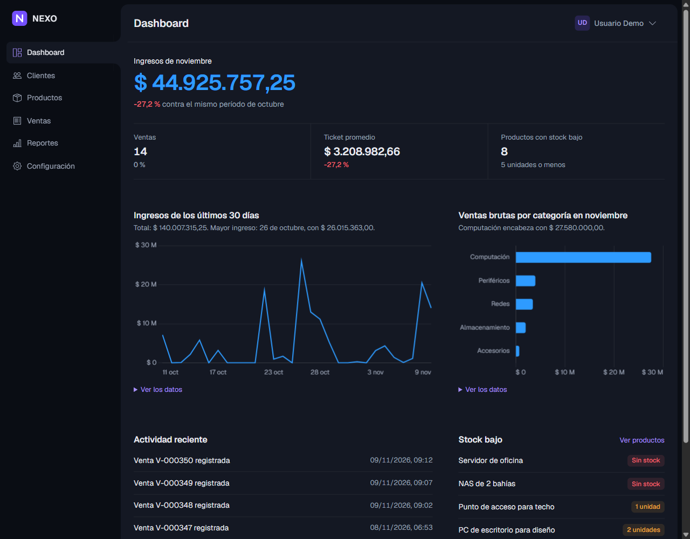
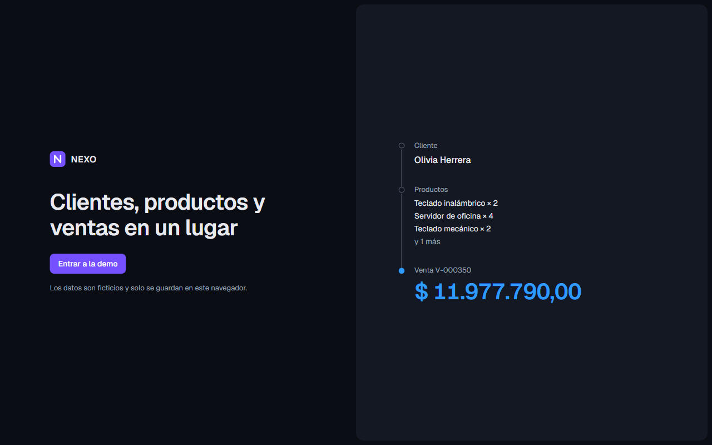
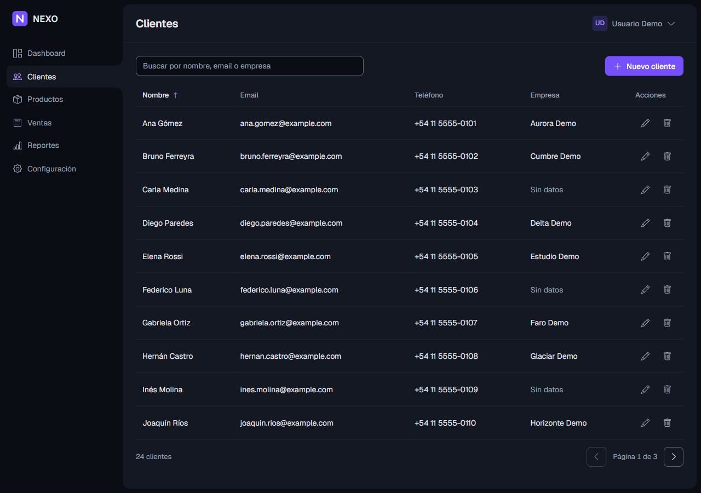
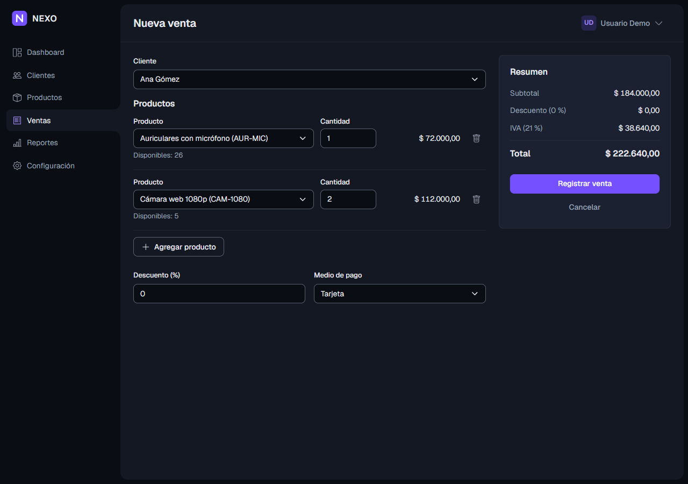
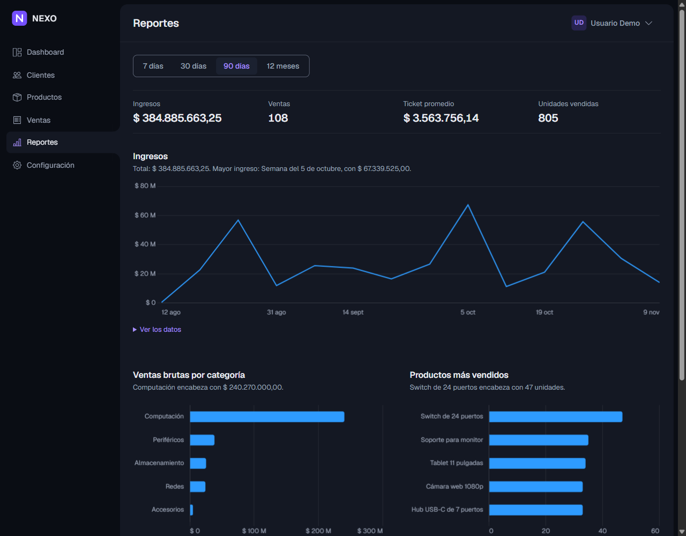
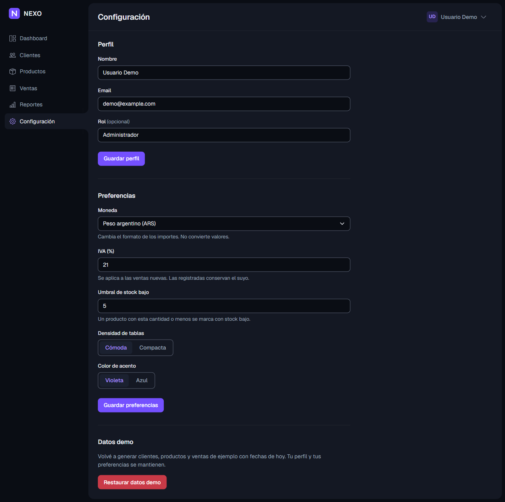
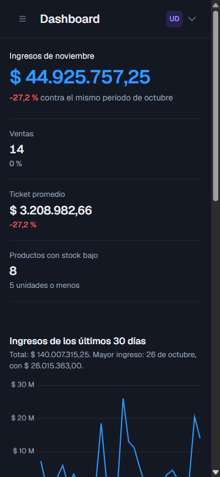
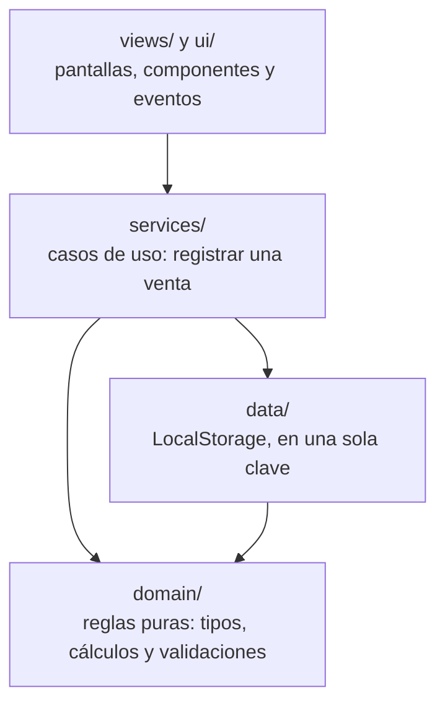

# NEXO

NEXO es una aplicación web de gestión para un negocio chico: clientes, productos, ventas y reportes, en una sola página. Es un proyecto de portfolio: no tiene servidor ni cuentas de usuario, y los datos son ficticios. Se generan al entrar y se guardan en el navegador, así que cualquiera puede probarla sin registrarse.



## Características

- **Acceso demo:** un botón para entrar, sin contraseña. Muestra la última venta registrada.
- **Dashboard:** ingresos, ventas y ticket promedio del mes, comparados con el mismo período del mes anterior; ingresos de los últimos 30 días; ventas por categoría; actividad reciente y productos con stock bajo. Si los datos quedaron viejos, ofrece generarlos de nuevo con fechas de hoy.
- **Clientes:** búsqueda que ignora tildes y mayúsculas, orden por columna, paginación, alta, edición y baja, con validación y email único.
- **Productos:** lo mismo que Clientes, más filtro por categoría, "Solo stock bajo" y SKU único. Los precios se guardan en centavos para no perder precisión.
- **Ventas:** una venta puede tener varios productos, con el stock disponible a la vista, descuento, medio de pago e IVA, y un resumen que se actualiza mientras se completa. El historial se filtra por número, cliente, estado y fechas. Una venta se puede anular, y al anularla el stock vuelve.
- **Reportes:** períodos de 7, 30 y 90 días y de 12 meses, con ingresos, ventas, ticket promedio, unidades, ventas por categoría, productos más vendidos y mejores clientes.
- **Configuración:** perfil, moneda (solo cambia el formato), IVA, umbral de stock bajo, densidad de las tablas y color de acento. También permite restaurar los datos demo, conservando el perfil y las preferencias.
- **En toda la app:**
  - Funciona de 320 a 1920 px, y en pantallas táctiles cada control mide al menos 44 px.
  - Se usa entera con el teclado. Los cambios importantes se anuncian a los lectores de pantalla, y cada gráfico tiene sus datos en una tabla.
  - Los colores cumplen el contraste AA.
  - Tiene una Content-Security-Policy estricta.
  - Si los datos guardados se dañan, se guarda una copia, se cargan los datos demo y se avisa. Si el navegador no permite guardar, la app funciona en memoria y lo avisa.

## Tecnologías

| Tecnología        | Versión                 | Para qué                                                                                                      |
| ----------------- | ----------------------- | ------------------------------------------------------------------------------------------------------------- |
| TypeScript        | 6.0.3                   | Todo el código, en modo estricto y sin `any`                                                                  |
| Vite              | 8.3.5                   | Servidor de desarrollo y build                                                                                |
| Bootstrap         | 5.3.8                   | Grilla, formularios y el comportamiento de modales, menús, avisos y menú lateral. El aspecto visual es propio |
| SCSS (Sass)       | 1.107.1                 | Estilos con tokens de diseño                                                                                  |
| Chart.js          | 4.6.1                   | Gráficos, importado por partes                                                                                |
| Vitest            | 5.1.0                   | Tests, con cobertura de V8                                                                                    |
| ESLint y Prettier | 10.14.0 y 3.9.10        | Reglas de código y formato                                                                                    |
| Docker y nginx    | Node 26 y nginx estable | Imagen de producción para Cloud Run: Node compila y nginx sirve                                               |

No hay framework (React, Angular o Vue): la app tiene ocho pantallas, y armarla con TypeScript, una plantilla HTML que escapa los datos y un router propio de unas 240 líneas ([`router.ts`](src/app/router.ts) y [`routes.ts`](src/app/routes.ts)) muestra las bases que un framework esconde.

## Instalación y ejecución local

Hace falta [Node.js](https://nodejs.org/) 26 o posterior.

Instalar las dependencias exactas del `package-lock.json`:

```bash
npm ci
```

npm puede avisar que `@parcel/watcher` tiene un script de instalación sin aprobar. No hace falta aprobarlo: esa dependencia de Sass usa el binario ya compilado para tu sistema.

Levantar el servidor de desarrollo, en `http://localhost:5173`:

```bash
npm run dev
```

Para probar la versión de producción, con la misma Content-Security-Policy que nginx, primero compilar:

```bash
npm run build
```

Y después servirla en `http://localhost:4173`:

```bash
npm run preview
```

## Pruebas

| Comando                 | Qué hace                                                                                        |
| ----------------------- | ----------------------------------------------------------------------------------------------- |
| `npm test`              | Corre los tests una vez                                                                         |
| `npm run test:coverage` | Corre los tests con cobertura y falla si `domain`, `services` o `data` bajan del 80 % de líneas |
| `npm run typecheck`     | Comprueba los tipos del código de la app y de los archivos que corren en Node                   |
| `npm run lint`          | Revisa el código con ESLint                                                                     |
| `npm run format:check`  | Comprueba el formato con Prettier                                                               |

El 9 de noviembre de 2026 pasaron más de 900 tests en 49 archivos. La cobertura de líneas fue del 100 % en `domain` y `data` y del 99,24 % en `services`.

Los tests corren en Node, sin navegador, con la zona horaria fija en Buenos Aires. Las pantallas se probaron en Chromium con scripts de Playwright hechos para cada etapa, usando mouse y teclado reales. Esos scripts no están en el repositorio.

## Capturas

|                                                                                                      |                                                                                                                                |
| ---------------------------------------------------------------------------------------------------- | ------------------------------------------------------------------------------------------------------------------------------ |
|  |                                            |
|               |  |
|            |                                                    |

## Arquitectura

La app es una SPA (una sola página que cambia de pantalla sin recargar) organizada en capas. Cada capa usa solo las de abajo:



- `domain` no usa el DOM, ni LocalStorage, ni la fecha del sistema: la recibe como parámetro. Por eso se prueba sin navegador.
- `services` recibe sus dependencias por parámetro (`database`, `generateId` y `now`), y en los tests se reemplazan.
- Las vistas leen con `database.read()` y solo modifican datos a través de los servicios.
- Los errores esperables no lanzan excepciones: se devuelven como `Result`, `{ ok: true, value }` o `{ ok: false, error }`.

**Cómo se registra una venta:**

1. La pantalla Nueva venta envía el formulario a `services.sales.register()`.
2. El servicio lee la base una vez y valida con funciones de `domain`: cliente, productos, cantidades y stock.
3. Arma el estado nuevo: la venta con sus totales, el stock descontado, la actividad y el número siguiente.
4. Lo guarda en una sola escritura. Si el almacenamiento falla, no cambia nada.
5. La pantalla recibe el `Result`. Si salió bien, avisa y va al historial; si no, marca los errores junto a cada campo.

**Estructura de carpetas:**

```text
├── deploy/            Cabeceras de seguridad, configuración de nginx y sus tests
├── docs/
│   ├── specs/         Documento de diseño
│   ├── plans/         El plan de cada etapa, con las decisiones tomadas al ejecutarlo
│   └── screenshots/   Capturas de la app
├── public/            Ícono
├── scripts/           Script que comprueba un despliegue y test de los enlaces de la documentación
├── src/
│   ├── main.ts        Crea las dependencias reales y arranca el router
│   ├── app/           Router, rutas, sesión y marco de la app (menú y barra superior)
│   ├── domain/        Tipos, dinero, ventas, stock, reportes, listas, fechas y validaciones
│   ├── data/          Esquema, base de datos en LocalStorage y datos demo
│   ├── services/      Clientes, productos, ventas y configuración
│   ├── ui/            Plantilla html con escape, formatos, gráficos y componentes
│   ├── views/         Una por pantalla
│   ├── styles/        Tokens, Bootstrap parcial, componentes y pantallas
│   └── testing/       Utilidades que solo usan los tests
├── Dockerfile
└── vite.config.ts, tsconfig*.json, eslint.config.js
```

## Seguridad y privacidad

- **LocalStorage no está cifrado.** Cualquiera con acceso al navegador puede leer los datos de la demo. Por eso no se piden contraseñas ni datos reales, y los datos demo usan direcciones de `example.com`.
- **Escape de datos:** todo dato que se muestra pasa por la plantilla `html` de [`src/ui/html.ts`](src/ui/html.ts), que escapa los caracteres especiales. Un nombre como `<script>` se muestra como texto.
- **Content-Security-Policy:** solo se ejecutan scripts y estilos del mismo sitio, y no se permite estilo escrito dentro del HTML. Las cabeceras están en [`deploy/security-headers.ts`](deploy/security-headers.ts) y se aplican igual en `npm run preview` y en nginx.
- **Dependencias:** `npm audit` informa 0 vulnerabilidades en las de producción. Las 9 moderadas que informa en desarrollo vienen de `minimatch`, que usan ESLint y `typescript-eslint`, y no llegan a la imagen.

## Despliegue

### Qué se publica

La imagen se construye en dos etapas. `node:26-alpine` instala las dependencias y compila la app; la imagen final es `nginx/nginx-unprivileged:stable-alpine` con los archivos de `dist/`, y no incluye Node ni dependencias de desarrollo. nginx corre sin root, escucha en el puerto 8080 y:

- devuelve `index.html` en cualquier ruta de la app, para que recargar `/clientes` funcione;
- devuelve 404 si se pide un archivo inexistente de `/assets/`;
- guarda un año los archivos de `/assets/`, porque su nombre cambia con el contenido, y pide de nuevo `index.html` en cada visita;
- envía en todas las respuestas las cabeceras de seguridad de [`deploy/security-headers.ts`](deploy/security-headers.ts): Content-Security-Policy, `X-Content-Type-Options: nosniff` y `Referrer-Policy: no-referrer`;
- comprime HTML, CSS, JS y SVG, y no publica su versión.

> **La imagen todavía no se construyó.** Docker no estaba instalado en la máquina donde se desarrolló la app. La configuración de nginx tiene tests que la leen como texto y la comparan con las cabeceras de [`deploy/security-headers.ts`](deploy/security-headers.ts), y el build se comprobó con los mismos archivos que entran a la imagen. Lo que falta es construirla, levantarla y pasarle `npm run check:deploy`.

### Requisitos

- [Docker Desktop](https://www.docker.com/products/docker-desktop/), para probar la imagen en tu computadora.
- Para publicar: la [CLI de Google Cloud](https://cloud.google.com/sdk/docs/install) y un proyecto de Google Cloud con facturación activa. Conviene crear una alerta de presupuesto en **Facturación → Presupuestos y alertas** antes de desplegar.

### Probar la imagen

Construir la imagen:

```bash
docker build -t nexo .
```

Levantarla en `http://localhost:8080`:

```bash
docker run --rm -p 8080:8080 nexo
```

En otra terminal, comprobar que cumple todo lo anterior:

```bash
npm run check:deploy -- http://localhost:8080
```

El script pide `index.html`, el JS de la app, dos pantallas recargadas, un archivo inexistente y el ícono, y revisa estado, tipo de contenido, `Cache-Control`, compresión y cabeceras de seguridad. Termina con código 0 si todo está en orden y con 1 si encuentra un problema.

### Publicar en Cloud Run

Cloud Run construye la imagen con el `Dockerfile` del proyecto, usando Cloud Build, y la guarda en un repositorio de Artifact Registry llamado `cloud-run-source-deploy`, que crea solo.

1. Iniciar sesión:

   ```bash
   gcloud auth login
   ```

2. Elegir el proyecto, cambiando `MI-PROYECTO` por su ID:

   ```bash
   gcloud config set project MI-PROYECTO
   ```

3. Habilitar Cloud Run y Cloud Build:

   ```bash
   gcloud services enable run.googleapis.com cloudbuild.googleapis.com
   ```

4. Dar permiso para compilar a la cuenta de servicio predeterminada de Compute Engine. Se hace una sola vez por proyecto, y tarda un par de minutos en aplicarse. Primero, ver el número del proyecto:

   ```bash
   gcloud projects describe MI-PROYECTO --format="value(projectNumber)"
   ```

   Después, con ese número en lugar de `NUMERO`:

   ```bash
   gcloud projects add-iam-policy-binding MI-PROYECTO --member=serviceAccount:NUMERO-compute@developer.gserviceaccount.com --role=roles/run.builder
   ```

5. Desplegar desde la carpeta del proyecto:

   ```bash
   gcloud run deploy nexo --source . --region southamerica-east1 --allow-unauthenticated --port 8080 --memory 512Mi --max-instances 1
   ```

| Opción                        | Por qué                                                                                 |
| ----------------------------- | --------------------------------------------------------------------------------------- |
| `--region southamerica-east1` | San Pablo, la región más cercana a Argentina                                            |
| `--allow-unauthenticated`     | La demo es pública: no pide iniciar sesión en Google                                    |
| `--port 8080`                 | El puerto en que escucha nginx sin root                                                 |
| `--memory 512Mi`              | Es el valor mínimo que admiten las dos generaciones de Cloud Run; nginx usa mucho menos |
| `--max-instances 1`           | Una demo no necesita más, y así el costo tiene un techo                                 |

Al terminar, `gcloud` muestra la URL del servicio.

### Comprobar la URL pública

Con la URL que mostró `gcloud`:

```bash
npm run check:deploy -- https://nexo-XXXXXXXX.southamerica-east1.run.app
```

Después, abrir la URL en el navegador, entrar a la demo, ir a Clientes y recargar la página.

### Borrar el servicio

Cuando ya no se use, borrar el servicio:

```bash
gcloud run services delete nexo --region southamerica-east1
```

Y el repositorio con las imágenes:

```bash
gcloud artifacts repositories delete cloud-run-source-deploy --location southamerica-east1
```

Documentación consultada: [Desplegar desde el código fuente](https://cloud.google.com/run/docs/deploying-source-code), [límites de memoria](https://cloud.google.com/run/docs/configuring/services/memory-limits), [contrato del contenedor](https://cloud.google.com/run/docs/reference/container-contract) y [referencia de `gcloud run deploy`](https://cloud.google.com/sdk/gcloud/reference/run/deploy).
